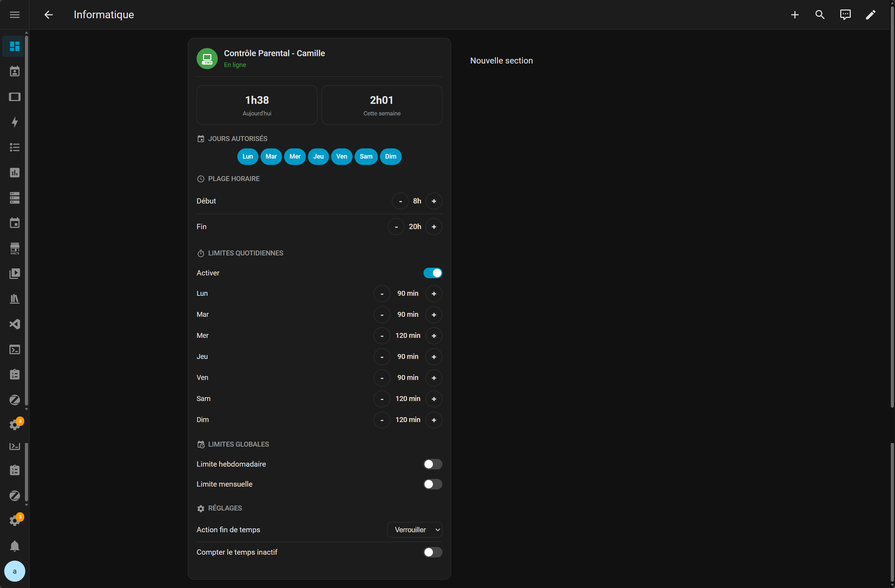

# Timekpra - Contrôle Parental pour Home Assistant

[](https://github.com/hacs/integration)

Intégration Home Assistant pour gérer [Timekpr-nExT](https://mjasnik.gitlab.io/timekpr-next/) (contrôle parental Linux) à distance via SSH.

Contrôlez le temps d'écran de vos enfants directement depuis votre dashboard Home Assistant, même quand leur ordinateur est éteint.



## Fonctionnalités

- **Profils prédéfinis** : basculez en un clic entre des configurations complètes (École, Vacances, Chez Papi Mamie...) — changement instantané dans l'interface
- **Profils personnalisés** : créez, modifiez et supprimez vos propres profils depuis la carte Lovelace
- **Déblocage temporaire** : profil intégré pour bypasser toutes les restrictions d'un clic
- **Limites quotidiennes** : réglables par jour (Lun-Dim), avec boutons +/- directement dans la carte
- **Limite hebdomadaire / mensuelle** : en heures, avec affichage "Illimité" quand désactivé
- **Plage horaire** : heure de début et fin d'accès autorisé
- **Jours autorisés** : toggle par jour de la semaine
- **Type de verrouillage** : lock / suspend / shutdown (menu déroulant)
- **Suivi du temps inactif** : on/off
- **Capteurs** : temps utilisé aujourd'hui et cette semaine, temps restant aujourd'hui (valeur calculée par Timekpr lui-même, bonus/pénalités compris)
- **Statut** : ordinateur en ligne / hors ligne
- **File d'attente offline** : les modifications sont mises en attente si l'ordinateur est éteint et appliquées automatiquement au rallumage (persistant entre redémarrages HA)
- **Carte Lovelace intégrée** : carte personnalisée installée automatiquement avec contrôles interactifs
- **Langues** : français, anglais et allemand (interface de l'intégration et carte, selon la langue de Home Assistant)

## Installation

> Home Assistant **2024.11 ou plus récent** est requis.

### Via HACS (recommandé)

1. Ouvrir HACS dans Home Assistant
2. Cliquer sur **Intégrations** > **⋮** (menu) > **Dépôts personnalisés**
3. Ajouter l'URL du dépôt : `https://github.com/tienou/ha-timekpra`
4. Catégorie : **Intégration**
5. Installer **Timekpra - Contrôle Parental**
6. Redémarrer Home Assistant

### Manuelle

Copier le dossier `custom_components/timekpra/` dans le répertoire `config/custom_components/` de votre Home Assistant, puis redémarrer.

## Configuration

### Prérequis sur la machine de l'enfant (Ubuntu / Linux)

- **Timekpr-nExT** installé (`sudo apt install timekpr-next`)
- **SSH** activé (`sudo apt install openssh-server`)
- Un compte utilisateur avec accès **sudo** (ex: `parents`)

> **Astuce** : En authentification par mot de passe, le mot de passe SSH est utilisé automatiquement pour les commandes `sudo`. Pas besoin de configuration sudoers spéciale. Pour l'authentification par clé SSH, voir la [section dédiée](#authentification-par-clé-ssh).

### Ajout dans Home Assistant

1. **Paramètres** > **Appareils et services** > **Ajouter une intégration**
2. Chercher **Timekpra**
3. Remplir :
   - **Hôte SSH** : IP de la machine de l'enfant (ex: `192.168.1.50`)
   - **Hôte SSH (VPN)** : *(optionnel)* IP quand l'enfant est connecté au VPN (ex: `10.0.0.2`)
   - **Port SSH** : `22` (par défaut)
   - **Utilisateur SSH** : compte avec accès sudo (ex: `parents`)
   - **Méthode d'authentification** : `Mot de passe` ou `Clé SSH`
   - **Mot de passe SSH** : mot de passe du compte *(si méthode = mot de passe)*
   - **Clé privée SSH** : la clé privée complète à coller *(si méthode = clé — voir ci-dessous)*
   - **Phrase secrète de la clé** : *(optionnel)* si la clé est protégée par une passphrase
   - **Mot de passe sudo** : *(optionnel)* mot de passe pour `sudo` sur la machine distante ; à laisser vide si `sudo` est en `NOPASSWD`
   - **Utilisateur Timekpra** : le login de l'enfant (ex: `camille`)

> Le formulaire affiche tous les champs en même temps : ne remplissez que ceux de la méthode choisie. Les identifiants non pertinents ne sont pas enregistrés.

### Authentification par clé SSH

L'authentification par clé évite de stocker un mot de passe et est recommandée. Comme la clé sert uniquement à ouvrir la session SSH (pas à `sudo`), il faut décider comment `sudo` s'authentifie :

**Option A — `sudo` sans mot de passe (`NOPASSWD`, recommandé)** : laissez le champ **Mot de passe sudo** vide. Les commandes utiliseront `sudo -n`.

```bash
# Sur la machine de l'enfant, en tant qu'admin :

# 1. Depuis Home Assistant (ou votre poste), générer une clé dédiée
ssh-keygen -t ed25519 -f ~/.ssh/timekpra -C "timekpra-ha"

# 2. Copier la clé publique sur le compte sudo de la machine de l'enfant
ssh-copy-id -i ~/.ssh/timekpra.pub parents@192.168.1.50

# 3. Autoriser le compte à utiliser sudo sans mot de passe (NOPASSWD)
echo "parents ALL=(ALL) NOPASSWD: ALL" | sudo tee /etc/sudoers.d/timekpra
sudo chmod 440 /etc/sudoers.d/timekpra
```

> Pour durcir, vous pouvez restreindre `NOPASSWD` aux seules commandes utilisées par l'intégration (`timekpra`, `test`, `cat`, `find`) au lieu de `ALL` — pensez à vérifier les chemins réels sur votre distribution (`which timekpra`), sinon `sudo` redemandera un mot de passe et les commandes échoueront.

Collez ensuite le contenu de la **clé privée** (`~/.ssh/timekpra`, en entier, lignes `-----BEGIN…` à `-----END…` comprises) dans le champ **Clé privée SSH** du formulaire.

**Option B — `sudo` avec mot de passe** : renseignez le champ **Mot de passe sudo** avec le mot de passe du compte SSH. Aucune ligne sudoers n'est nécessaire.

> **Sécurité** : la clé d'hôte SSH du serveur est épinglée à la première connexion (*Trust On First Use*, comme le client `ssh`). Si elle change ensuite (réinstallation de l'OS, ou tentative d'interception), la connexion est **refusée** et un message d'erreur est journalisé — supprimez puis ré-ajoutez l'intégration pour ré-épingler la nouvelle clé.

### Modifier la configuration

Pour changer les identifiants SSH (ou basculer entre mot de passe et clé) après l'installation :
**Paramètres** > **Appareils et services** > **Timekpra** > **Configurer**

## Carte Lovelace

La carte est **chargée automatiquement** par l'intégration (servie via `/timekpra/timekpra-card.js` et enregistrée comme module frontend) — **aucune ressource à ajouter à la main**. Pour l'ajouter à un dashboard :

1. Dashboard > **Modifier** > **Ajouter une carte**
2. Chercher **Timekpra** dans la liste des cartes
3. La carte affiche tous les contrôles avec des boutons **+/-** pour modifier les valeurs directement

> Après installation ou mise à jour, faites un **rechargement forcé** du navigateur (Ctrl+Shift+R) si la carte n'apparaît pas immédiatement — c'est du cache frontend.

> La carte est chargée comme **module frontend** : il est normal qu'elle n'apparaisse **pas** dans **Paramètres > Tableaux de bord > Ressources**. Si vous l'y aviez ajoutée à la main (`/local/timekpra-card.js`), vous pouvez supprimer cette ressource ; la laisser ne provoque pas d'erreur (la carte ne se déclare qu'une fois).

### Si la carte n'apparaît pas (secours manuel)

Si l'auto-chargement ne fonctionne pas (mode Lovelace YAML, version HA particulière…), ajoutez la ressource **manuellement** :

1. **Paramètres** > **Tableaux de bord** > **⋮** > **Ressources** > **Ajouter une ressource**
2. URL : `/timekpra/timekpra-card.js` *(ou `/local/timekpra-card.js`, également déployée)*
3. Type : **Module JavaScript**
4. Enregistrer, puis **Ctrl+Shift+R**

En mode **YAML**, déclarez plutôt dans la config Lovelace :

```yaml
resources:
  - url: /timekpra/timekpra-card.js
    type: module
```

### Fonctionnalités de la carte

- **Sélecteur de profil** : menu déroulant pour basculer instantanément entre les profils
- **Gestion des profils** : boutons pour créer, modifier et supprimer des profils personnalisés
- **Limites quotidiennes** : boutons ±15 min par jour, affiche "Illimité" à 1440 min
- **Limite hebdomadaire** : boutons ±1h, affiche "Illimité" à 168h
- **Limite mensuelle** : boutons ±1h, affiche "Illimité" à 744h
- **Plage horaire** : boutons ±1h pour début et fin
- **Jours autorisés** : toggles on/off
- **Type de verrouillage** : menu déroulant (lock/suspend/shutdown)
- **Statut en temps réel** : en ligne/hors ligne + commandes en attente

## Entités créées

| Type | Entités |
|------|---------|
| **Number** | Limite Lundi…Dimanche, Limite hebdo, Limite mensuelle, Heure début/fin |
| **Switch** | Jour autorisé Lundi…Dimanche, Compter le temps inactif, Limites quotidiennes on/off, Limite hebdo on/off, Limite mensuelle on/off, Déblocage temporaire |
| **Select** | Action fin de temps (lock/suspend/shutdown), Profil actif |
| **Sensor** | Temps utilisé aujourd'hui, Temps restant aujourd'hui, Temps utilisé cette semaine, Ordinateur (en ligne/hors ligne), Modifications en attente |

## Services

Deux services permettent de gérer les profils via script/automatisation (ils sont aussi accessibles directement depuis la carte) :

| Service | Description | Paramètres |
|---------|-------------|------------|
| `timekpra.save_profile` | Sauvegarde les réglages actuels dans un profil nommé | `name` (requis) · `entry_id` (optionnel si un seul appareil) |
| `timekpra.delete_profile` | Supprime un profil utilisateur | `name` (requis) · `entry_id` (optionnel) |

```yaml
service: timekpra.save_profile
data:
  name: "Examens"
```

## Fonctionnement technique

- Connexion SSH via `asyncssh`, authentification par **mot de passe** ou **clé privée** (au choix)
- **Clé d'hôte épinglée** (*Trust On First Use*) : refus de connexion si la clé du serveur change
- `sudo` authentifié par mot de passe (`sudo -S`) ou sans mot de passe (`sudo -n` / `NOPASSWD`)
- **Fallback VPN** : si l'IP locale est injoignable et une IP VPN est configurée, la connexion est tentée automatiquement sur l'IP VPN
- Lecture de la config depuis `/var/lib/timekpr/config/timekpr.{user}.conf`
- Temps utilisé / restant lus via `timekpra --userinfo` (valeurs de Timekpr, ajustements manuels compris ; repli sur le fichier `/var/lib/timekpr/work/{user}.time` si la commande n'est pas disponible)
- Écriture via la CLI `timekpra` (ex: `timekpra --settimelimits`)
- Rafraîchissement toutes les 5 minutes, sur une seule connexion SSH ; délais d'attente de 15 s (connexion) et 30 s (commande) pour ne jamais bloquer Home Assistant
- File d'attente persistante pour les commandes quand la machine cible est hors ligne
- Vérification du code retour : une commande qui échoue sur la machine (mauvais mot de passe sudo, règle NOPASSWD manquante, erreur `timekpra`…) est journalisée et signalée via « Modifications en attente » au lieu d'être silencieusement ignorée

## Historique

### v1.24.0

- **Temps restant aujourd'hui juste** ([#3](https://github.com/tienou/ha-timekpra/issues/3)) : la valeur vient désormais de Timekpr (`timekpra --userinfo`) et tient compte des bonus/pénalités ajoutés ponctuellement. Exemple : 4 h autorisées, −1 h de pénalité, 20 min utilisées → 2h40 (au lieu de 3h40).
- **Carte chargée automatiquement** ([#2](https://github.com/tienou/ha-timekpra/issues/2)) : enregistrement comme module frontend confirmé (dépendance `frontend` déclarée), sans ressource à ajouter à la main.
- **Anglais et allemand** : noms d'entités, états, configuration, services et carte traduits (FR/EN/DE).
- **Limites par jour** : quand un jour était désactivé, les limites des jours suivants étaient décalées d'un cran sur la machine (Timekpr les range dans l'ordre des jours autorisés). Corrigé à l'écriture et à la lecture.
- **Déblocage temporaire** : débloque aussi un jour non autorisé ; le resélectionner pendant qu'il est actif n'écrase plus les réglages à restaurer.
- **Fiabilité** : délais d'attente SSH, lecture de config ratée qui n'est plus prise pour une config « par défaut », compteurs remis à zéro après minuit même machine éteinte, plage horaire inversée refusée avec un message clair, login de l'enfant vérifié à la configuration.

**À savoir en mettant à jour** : les identifiants internes changent pour permettre la traduction — l'état du capteur « Ordinateur » vaut `online`/`offline` (au lieu de `En ligne`/`Hors ligne`) et les profils prédéfinis ont pour identifiants `custom`, `override`, `school`, `holidays`, `grandparents` (l'affichage reste en français). Les profils enregistrés sont migrés automatiquement ; seules les automatisations qui testaient ces valeurs texte sont à adapter.

Merci à **Markus Ullmann ([@Morjgus](https://github.com/Morjgus))** pour l'enregistrement de la carte ([#4](https://github.com/tienou/ha-timekpra/pull/4)) et l'internationalisation EN/DE/FR ([#5](https://github.com/tienou/ha-timekpra/pull/5)).

## Licence

MIT
